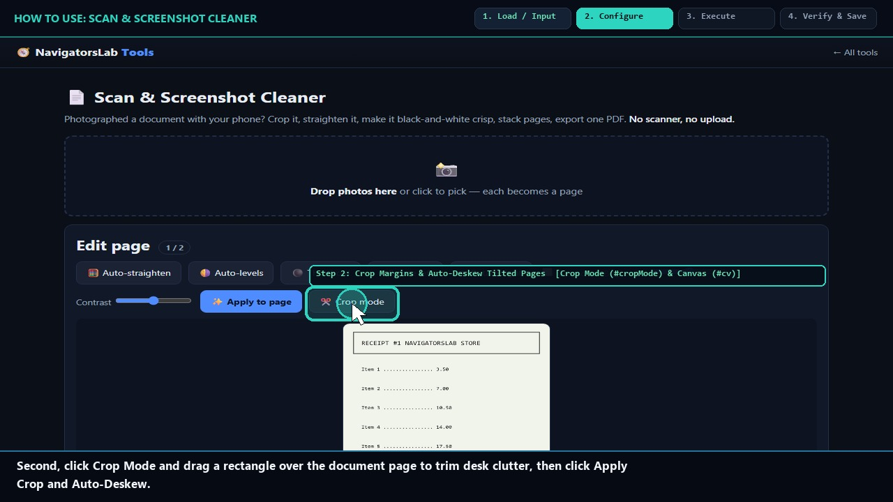
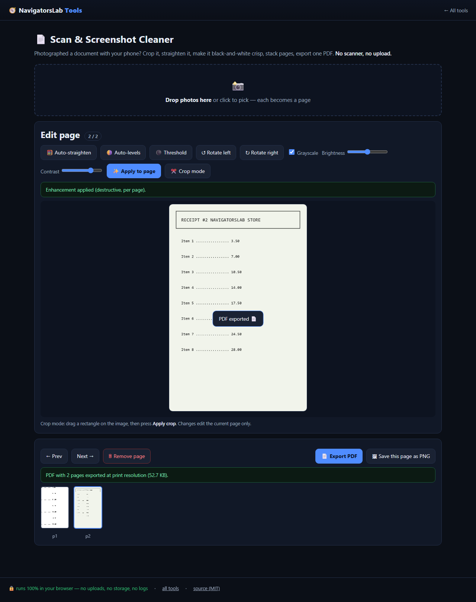

# 📄 Scan & Screenshot Cleaner

> Phone photos of documents → clean, straight PDFs

     

<h4 align="center">
  &#9654; <a href="https://navigatorslab.com/tools/scan.html">Open it on navigatorslab.com</a> &mdash; free, no sign-up, nothing uploaded<br>
  <a href="https://navigatorslab.com/Scan-Cleaner">navigatorslab.com/Scan-Cleaner</a> &middot; <a href="https://navigatorslab.com/tools/videos/scan.mp4">🔊 Watch Narrated Step-by-Step Tutorial Video</a> &middot; <a href="https://navigatorslab.com/tools/videos/notebooklm-overview.mp4">Watch Full Suite Hands-On Video</a><br>
  This repo's Pages site runs the <em>actual tool</em>: <code>demo.html</code>
</h4>



Phone-photo documents in, clean PDFs out: auto-straighten, auto-levels, photocopy threshold, fit-to-view crop, 300 DPI text.

## 📖 Complete Step-by-Step User Guide

### Step 1: Drop Phone Photos of Paper Documents (`Document Dropzone (#dz)`)
- **How to do it:** Drop phone camera photos of contracts, forms, book pages, or whiteboards onto `#dz`. Multiple photos become pages of a multi-page document.
- **Expected result:** Page thumbnails appear in `#thumbs` and the first page loads into the interactive canvas (`#cv`).

### Step 2: Crop Margins & Auto-Deskew Tilted Pages (`Crop Mode (#cropMode) & Canvas (#cv)`)
- **How to do it:** Click **Crop mode (`#cropMode`)**, drag a bounding rectangle across the document on `#cv`, and click **Apply crop (`#applyCropBtn`)**. Use deskew controls to straighten tilted camera angles.
- **Expected result:** Background desk surfaces and perspective tilt are removed cleanly.

### Step 3: Apply Grayscale, Auto-Levels & Contrast Boost (`Enhancement Controls (#gray, #contrast, #applyEnh)`)
- **How to do it:** Check **Grayscale (`#gray`)**, adjust the **Contrast (`#contrast`)** or photocopy threshold slider to bleach gray paper shadows to pure white while sharpening dark ink, and click **Apply (`#applyEnh`)**.
- **Expected result:** Dim, shadowed phone photos transform into crisp, high-contrast black-and-white scans.

### Step 4: Export as a Multi-Page 300-DPI PDF or PNG (`Export 300-DPI PDF Button (#pdf)`)
- **How to do it:** Use **Next page (`#next`)** to review additional pages, then click **Export 300-DPI PDF (`#pdf`)** (or **Export PNG** for single images).
- **Expected result:** A clean, properly sized 300-DPI multi-page PDF downloads locally.

## 🎛️ UI Controls, Shortcuts & Parameters Reference

| Control / Shortcut | What It Does |
|---|---|
| `Crop Mode (`#cropMode` + `#applyCropBtn`)` | Interactive drag-rectangle crop directly on the live page preview canvas (`#cv`). |
| `Grayscale (`#gray`) & Contrast (`#contrast`)` | Converts color phone photos to crisp monochrome document scans and removes lighting shadows. |
| `Apply Enhancements (`#applyEnh`)` | Commits deskew, auto-levels, grayscale, and contrast adjustments to the active page. |
| `Export 300-DPI PDF (`#pdf`)` | Packs all cleaned pages into a single 300-DPI PDF via `pdf-lib`. |

## 💡 Pro Tips & Real-World Workflows

- 💡 Shoot paper documents against a darker desk or table surface so the page edges are easy to align and crop.
- 💡 Set Contrast between `35` and `50` with Grayscale enabled to replicate a laser-printer photocopy look.
- 💡 After exporting your cleaned PDF, you can open it directly in **Local E-Sign Pad (`sign.html`)** to sign and date it.

## 🧪 Concrete Example: Input → Engine → Output

| Stage | What Happens | Details |
|---|---|---|
| **1. Raw Input** | **3 Phone Photos of a Lease on a Gray Desk** | Tilted +2.8°, uneven warm lamp shadow, desk background visible around page edges |
| **2. On-Device Engine** | **Content-aware ±4° deskew search + auto-levels + adaptive photocopy threshold + 300-DPI pdf-lib assembly** | Runs 100% client-side in your browser tab under strict `CSP` (`connect-src 'none'`). |
| **3. Verified Output** | **lease-cleaned-300dpi.pdf (3 Pages)** | Straightened to 0.0°, pure white paper background, razor-sharp black text, combined into one 300-DPI PDF |

```text
Deskew: -2.8 deg | Auto-Levels: 18..238 -> 0..255 | Output: 3-page 300-DPI PDF [OK]
```

- 🔊 **Narrated Step-by-Step Usage Tutorial Video (`33s`):** [`demo.mp4`](./demo.mp4) (also live at [`https://navigatorslab.com/tools/videos/scan.mp4`](https://navigatorslab.com/tools/videos/scan.mp4))
- 🎬 **Full Suite Hands-On Video Guide:** [`https://navigatorslab.com/tools/videos/notebooklm-overview.mp4`](https://navigatorslab.com/tools/videos/notebooklm-overview.mp4)

## ✅ What it does

- Auto-crop, auto-levels and photocopy-style threshold for crisp scans
- Fix phone photos of whiteboards, documents and screenshots in seconds
- Export a clean PNG or a print-ready 300-DPI PDF

## 🚀 Try it in 30 seconds

1. Photograph the document with your phone
2. Auto-straighten, auto-levels, threshold
3. Export PNG or a 300-DPI PDF

## 📸 Live UI in action



## 🔒 Private by design

- **100% on-device** — files are processed in your browser and **never uploaded** to any server
- **No accounts, no tracking, no cookies, nothing retained** — open the page and work
- **Works offline** once loaded; fully mobile-friendly
- **Free & open source (MIT)** — use it at home, at work, anywhere

## 🤖 Built for humans *and* AI agents

- Deep-linkable via URL parameters — see the [Agent Mode guide](https://navigatorslab.com/tools/agents.html)
- Machine-readable catalog: [llms.txt](https://navigatorslab.com/tools/llms.txt) · [llms-full.txt](https://navigatorslab.com/tools/llms-full.txt)
- MCP endpoint: `POST https://navigatorslab.com/tools/mcp` (tool catalog + deterministic text tools — see the [main repo](https://github.com/Kayforkind/NavigatorsLab-Tools))
- No build step required to *use* any tool — just the URL

## 🛠 Under the hood

Canvas pixel ops (deskew, auto-levels, threshold); pdf-lib for the 300-DPI PDF

Third-party components are catalogued in [NOTICE](NOTICE); this repo is MIT-licensed ([LICENSE](LICENSE)).

## 🗂 The NavigatorsLab Tools suite

The full catalog — every tool in the hub with the same zero-upload promise, plus the lab's apps, CLIs and engines:

| Tool | What it does | |
|---|---|---|
| 🛡 Photo Privacy Kit | Strip GPS, camera model and timestamps before posting | [Open](https://navigatorslab.com/tools/exif.html) |
| 🔐 Password Breach Checker | Has this password been breached? — it never leaves your tab | [Open](https://navigatorslab.com/tools/breachcheck.html) |
| 🔍 Metadata & Hidden-Data Checker | See what's really inside a file — then strip it | [Open](https://navigatorslab.com/tools/metadata.html) |
| 🗜 Image Shrinker | Hit “max 2 MB” portal limits without TinyPNG | [Open](https://navigatorslab.com/tools/shrink.html) |
| **📄 Scan & Screenshot Cleaner** | Phone photos of documents → clean, straight PDFs | [Open](https://navigatorslab.com/tools/scan.html) |
| ✍ Local E-Sign Pad | Sign this lease tonight — not DocuSign | [Open](https://navigatorslab.com/tools/sign.html) |
| 🧾 Receipts → One PDF | Shoebox of receipt photos → one date-sorted PDF | [Open](https://navigatorslab.com/tools/receipts.html) |
| 🔢 Receipt OCR → CSV | Read totals off receipt photos, export for expenses | [Open](https://navigatorslab.com/tools/ocr.html) |
| 🔳 QR Studio | Generate QR codes and decode QR images — no site sees them | [Open](https://navigatorslab.com/tools/qr.html) |
| 🎧 Audio Trimmer | Cut voice notes and clips on a waveform | [Open](https://navigatorslab.com/tools/audio.html) |
| 🧮 Invoice / Quote Generator | One-person shops: hours in, clean PDF out | [Open](https://navigatorslab.com/tools/invoice.html) |
| 🗂 Batch Rename & Sort | IMG_5847.jpg → 2026-09-05-receipt-home-depot.jpg | [Open](https://navigatorslab.com/tools/rename.html) |
| 🖨 Print-Shop Prep | Exact sizes, bleed, DPI checks, print-ready PDF | [Open](https://navigatorslab.com/tools/printprep.html) |
| 📑 PDF Pages | Reorder, rotate, delete and extract PDF pages | [Open](https://navigatorslab.com/tools/pdfpages.html) |
| 🔬 Text Diff | Compare two texts with word-level highlights | [Open](https://navigatorslab.com/tools/textdiff.html) |
| 🎨 Reimagine | Redesign any HTML page from its own content | [Open](https://navigatorslab.com/reimagine/) |
| 📊 Text Stats | Words, reading time, readability, keyword density | [Open](https://navigatorslab.com/tools/textstats.html) |
| 📜 PDF Studio | Edit the text inside your PDF — private, free, open source | [Open](https://navigatorslab.com/pdf-studio/) |
| 🩺 Design Health | 18 deterministic design-quality checks for HTML — no LLM, no API key | [Open](https://github.com/Kayforkind/design-health-action) |
| 🔪 Skill Slice | Copy one Read-verified skill folder — a slice, not the pie | [Open](https://github.com/Kayforkind/skill-slice) |
| 🕵 liecatchers | Your agent said Done. Prove it — ten sensors, one RECEIPT.json | [Open](https://github.com/Kayforkind/liecatchers) |
| 📚 Book Guide MCP | Ship improvements with your books — agents cite, run playbooks, learn | [Open](https://github.com/Kayforkind/book-guide-mcp) |
| 📡 Data Insights | Founder intelligence — daily & weekly tech signal briefs | [Open](https://github.com/Kayforkind/data-insights) |
| 🪓 Iron Axe: Legacy | An original side-scrolling beat 'em up — Godot 4 | [Open](https://github.com/Kayforkind/iron-axe-legacy) |

---

<p align="center">
  <b>One hub, twenty-four projects:</b> <a href="https://navigatorslab.com/tools/">https://navigatorslab.com/tools</a><br>
  <b>Source &amp; the whole suite:</b> <a href="https://github.com/Kayforkind/NavigatorsLab-Tools">https://github.com/Kayforkind/NavigatorsLab-Tools</a>
</p>
